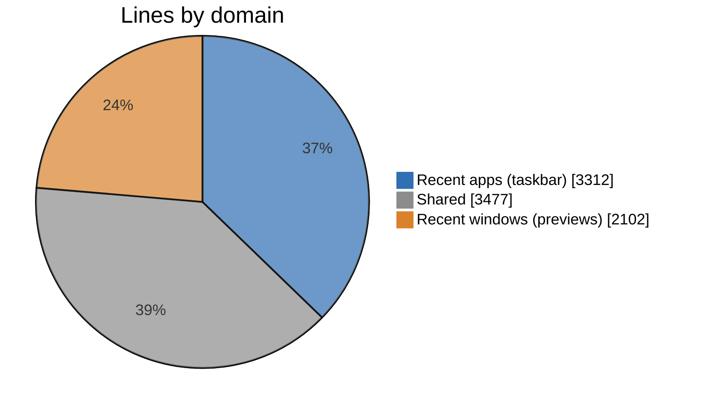
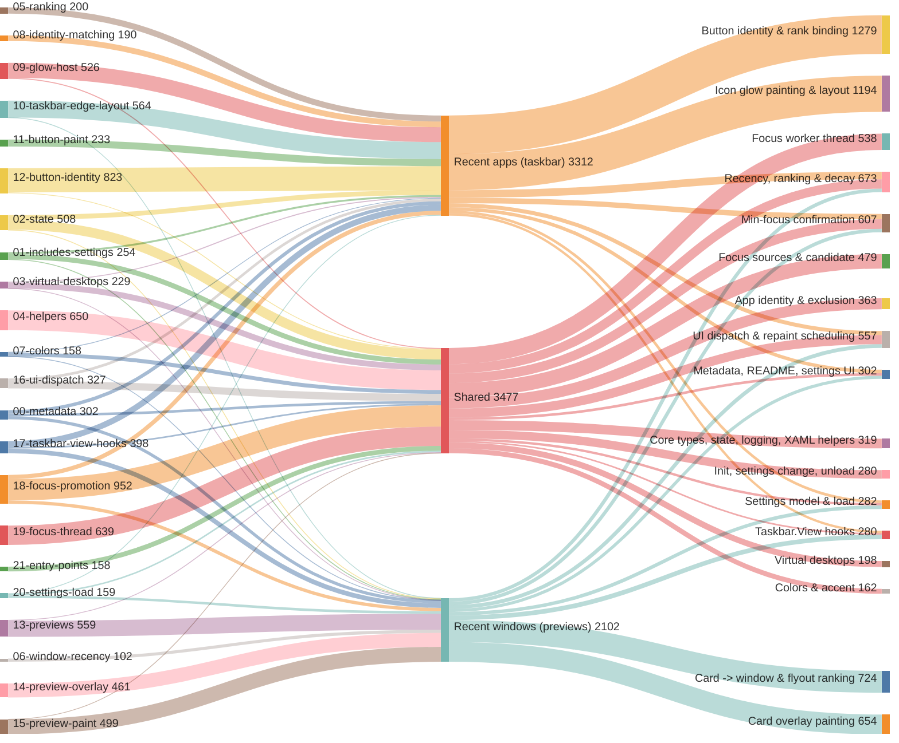
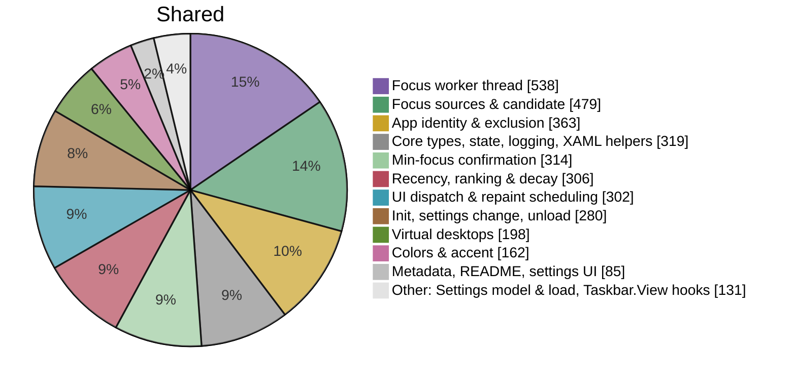
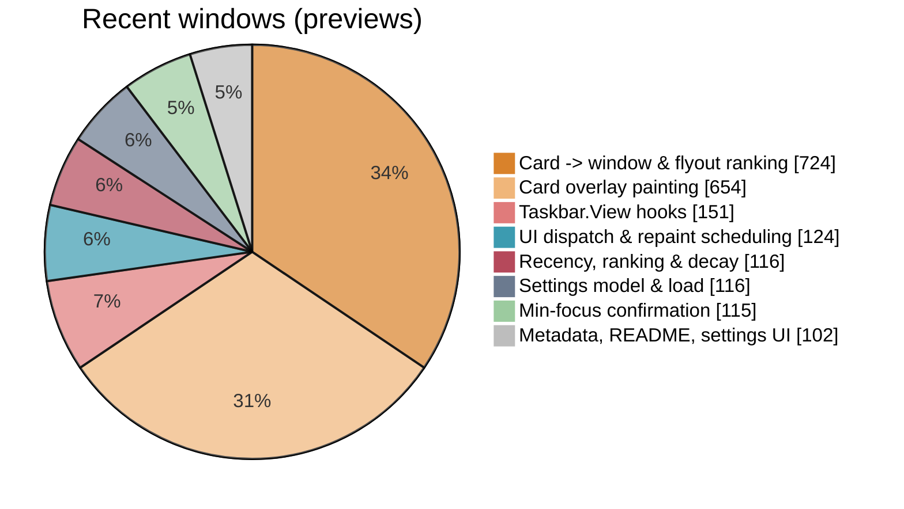

# Code breakdown: recent apps vs recent windows

<!-- Generated by tools/code_breakdown.py from src/. Do not edit by hand; rerun the script. -->

The mod is 8891 lines in 22 parts under `src/` (7081 code lines: not blank, not comment, metadata excluded). Every line is assigned to one of three domains and one feature area by `tools/code_breakdown.py` (classification per function, struct and global; comments go with the item below them).

| Domain | What it is | Lines | Share | Code lines |
|---|---|---:|---:|---:|
| **Recent apps (taskbar)** | Taskbar icon ranks: app recency, button identity, glow painting | 3312 | 37.3 % | 2632 |
| **Shared** | Focus sources, min-focus machine, desktops, identity, threads, lifecycle | 3477 | 39.1 % | 2762 |
| **Recent windows (previews)** | Flyout card ranks: window recency, card -> window, card painting | 2102 | 23.6 % | 1687 |

## Domain split

Without the shared part, the taskbar half is 61.2 % and the preview half 38.8 % of the feature-specific code.

## Where the lines go

Left: source parts. Middle: domain. Right: feature area. An area fed by more than one domain has a shared core plus feature-specific branches (for example the min-focus machine: one shared state machine, an app track and a preview track).

## Feature areas inside each domain

### Recent apps (taskbar) (3312 lines)

### Shared (3477 lines)

### Recent windows (previews) (2102 lines)

## Feature area x domain

Lines (code lines in brackets). A feature with numbers in more than one column is partly shared.

| Feature area | Recent apps | Shared | Recent windows | Total |
|---|---:|---:|---:|---:|
| Button identity & rank binding | 1279 (1042) |  |  | 1279 |
| Icon glow painting & layout | 1194 (1018) |  |  | 1194 |
| Card -> window & flyout ranking |  |  | 724 (619) | 724 |
| Recency, ranking & decay | 251 (190) | 306 (260) | 116 (101) | 673 |
| Card overlay painting |  |  | 654 (540) | 654 |
| Min-focus confirmation | 178 (138) | 314 (233) | 115 (106) | 607 |
| UI dispatch & repaint scheduling | 131 (108) | 302 (256) | 124 (107) | 557 |
| Focus worker thread |  | 538 (461) |  | 538 |
| Focus sources & candidate |  | 479 (371) |  | 479 |
| App identity & exclusion |  | 363 (296) |  | 363 |
| Core types, state, logging, XAML helpers |  | 319 (257) |  | 319 |
| Metadata, README, settings UI | 115 (0) | 85 (0) | 102 (0) | 302 |
| Settings model & load | 87 (75) | 79 (61) | 116 (93) | 282 |
| Init, settings change, unload |  | 280 (231) |  | 280 |
| Taskbar.View hooks | 77 (61) | 52 (46) | 151 (121) | 280 |
| Virtual desktops |  | 198 (161) |  | 198 |
| Colors & accent |  | 162 (129) |  | 162 |
| **Total** | **3312** | **3477** | **2102** | **8891** |

## Source parts

How pure each part is. Mixed parts are where the two halves meet.

| Part | Lines | Recent apps | Shared | Recent windows | Mostly |
|---|---:|---:|---:|---:|---|
| `00-metadata.cpp` | 302 | 115 | 85 | 102 | Recent apps (taskbar) (38 %) |
| `01-includes-settings.cpp` | 254 | 61 | 165 | 28 | Shared (65 %) |
| `02-state.cpp` | 508 | 159 | 321 | 28 | Shared (63 %) |
| `03-virtual-desktops.cpp` | 229 | 32 | 192 | 5 | Shared (84 %) |
| `04-helpers.cpp` | 650 |  | 650 |  | Shared |
| `05-ranking.cpp` | 200 | 200 |  |  | Recent apps (taskbar) |
| `06-window-recency.cpp` | 102 |  |  | 102 | Recent windows (previews) |
| `07-colors.cpp` | 158 | 27 | 129 | 2 | Shared (82 %) |
| `08-identity-matching.cpp` | 190 | 190 |  |  | Recent apps (taskbar) |
| `09-glow-host.cpp` | 526 | 493 | 33 |  | Recent apps (taskbar) (94 %) |
| `10-taskbar-edge-layout.cpp` | 564 | 560 |  | 4 | Recent apps (taskbar) |
| `11-button-paint.cpp` | 233 | 233 |  |  | Recent apps (taskbar) |
| `12-button-identity.cpp` | 823 | 797 | 26 |  | Recent apps (taskbar) (97 %) |
| `13-previews.cpp` | 559 |  | 29 | 530 | Recent windows (previews) (95 %) |
| `14-preview-overlay.cpp` | 461 |  |  | 461 | Recent windows (previews) |
| `15-preview-paint.cpp` | 499 |  | 4 | 495 | Recent windows (previews) |
| `16-ui-dispatch.cpp` | 327 | 87 | 240 |  | Shared (73 %) |
| `17-taskbar-view-hooks.cpp` | 398 | 195 | 52 | 151 | Recent apps (taskbar) (49 %) |
| `18-focus-promotion.cpp` | 952 | 137 | 705 | 110 | Shared (74 %) |
| `19-focus-thread.cpp` | 639 |  | 639 |  | Shared |
| `20-settings-load.cpp` | 159 | 26 | 49 | 84 | Recent windows (previews) (53 %) |
| `21-entry-points.cpp` | 158 |  | 158 |  | Shared |

## Largest items

Functions and types over 60 lines (with their leading comments).

| Item | Part | Domain | Area | Lines |
|---|---|---|---|---:|
| `ApplyThumbnailHighlight` | 15-preview-paint | Recent windows (previews) | Card overlay painting | 289 |
| `HandleForegroundChanged` | 18-focus-promotion | Shared | Focus sources & candidate | 211 |
| `ApplyAllHighlights_UIThread` | 12-button-identity | Recent apps (taskbar) | Button identity & rank binding | 194 |
| `RefreshThumbnailFlyout_UIThread` | 15-preview-paint | Recent windows (previews) | Card -> window & flyout ranking | 180 |
| `ApplyButtonHighlight` | 11-button-paint | Recent apps (taskbar) | Icon glow painting & layout | 150 |
| `RecomputeRanksForDesktopLocked` | 05-ranking | Recent apps (taskbar) | Recency, ranking & decay | 119 |
| `HookThreadWndProc` | 19-focus-thread | Shared | Focus worker thread | 118 |
| `CaptureButton` | 12-button-identity | Recent apps (taskbar) | Button identity & rank binding | 117 |
| `DropExcludedRecords` | 19-focus-thread | Shared | Init, settings change, unload | 116 |
| `EnsureIconPanelLayoutWatch` | 10-taskbar-edge-layout | Recent apps (taskbar) | Icon glow painting & layout | 113 |
| `WinEventHookThread` | 19-focus-thread | Shared | Focus worker thread | 112 |
| `PaintNativeContour` | 09-glow-host | Recent apps (taskbar) | Icon glow painting & layout | 110 |
| `OnMinFocusTimerElapsed` | 18-focus-promotion | Recent apps (taskbar) | Min-focus confirmation | 110 |
| `OnDecayTimer` | 18-focus-promotion | Shared | Recency, ranking & decay | 102 |
| `DetectTaskbarEdge` | 10-taskbar-edge-layout | Recent apps (taskbar) | Icon glow painting & layout | 97 |
| `HookTaskbarViewDllSymbols` | 17-taskbar-view-hooks | mixed |  | 95 |
| `LoadSettings` | 20-settings-load | mixed |  | 84 |
| `HandleWindowDestroyed` | 18-focus-promotion | Shared | Recency, ranking & decay | 80 |
| `Wh_ModUninit` | 21-entry-points | Shared | Init, settings change, unload | 78 |
| `RefreshButtonHighlight` | 17-taskbar-view-hooks | Recent apps (taskbar) | Button identity & rank binding | 76 |
| `ReadPlateShapes` | 09-glow-host | Recent apps (taskbar) | Icon glow painting & layout | 75 |
| `WatchRepeaterElementClearing_UIThread` | 13-previews | Recent windows (previews) | Card -> window & flyout ranking | 74 |
| `SchedulePreviewFlyoutRefresh` | 14-preview-overlay | Recent windows (previews) | UI dispatch & repaint scheduling | 74 |
| `ActivateFocusTracking` | 19-focus-thread | Shared | Focus worker thread | 71 |
| `ResolveHwndFromCardViewModel` | 13-previews | Recent windows (previews) | Card -> window & flyout ranking | 66 |
| `ResolveAppIdentity` | 04-helpers | Shared | App identity & exclusion | 64 |
| `RevokeIconPanelLayoutWatchesOnThisDispatcher` | 10-taskbar-edge-layout | Recent apps (taskbar) | Icon glow painting & layout | 63 |
| `MinFocusDeadlineReached` | 18-focus-promotion | Shared | Min-focus confirmation | 62 |
| `PaintCardOverlay` | 14-preview-overlay | Recent windows (previews) | Card overlay painting | 61 |
| `ParseHexColor` | 07-colors | Shared | Colors & accent | 60 |

## How the classification works

- Domain = which half of the mod needs the item. *Shared* means both halves call it, or it is infrastructure neither works without (focus worker, settings snapshot, UI dispatch, unload).
- Items are classified one by one in `ITEM` in `tools/code_breakdown.py`; unlisted items take their part's default (`FILE_DEFAULT`). A forward declaration takes the class of the definition it declares.
- Items that mix both halves line by line use line ranges (`OVERRIDES`): the README and settings YAML in `00-metadata`, the `Settings` struct, `LoadSettings`, and the Taskbar.View hook table.
- `HandleForegroundChanged`, `OnDecayTimer`, `HandleWindowDestroyed` and `Wh_ModSettingsChanged` serve both halves in one body and count as shared.
- After moving or renaming functions, rerun the script; it warns about classification entries that no longer match an item.
