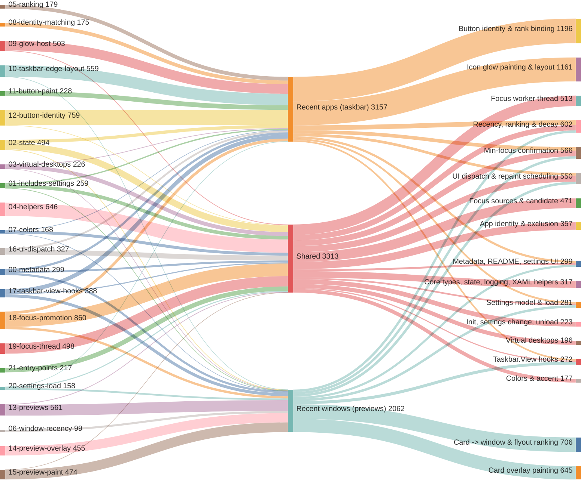
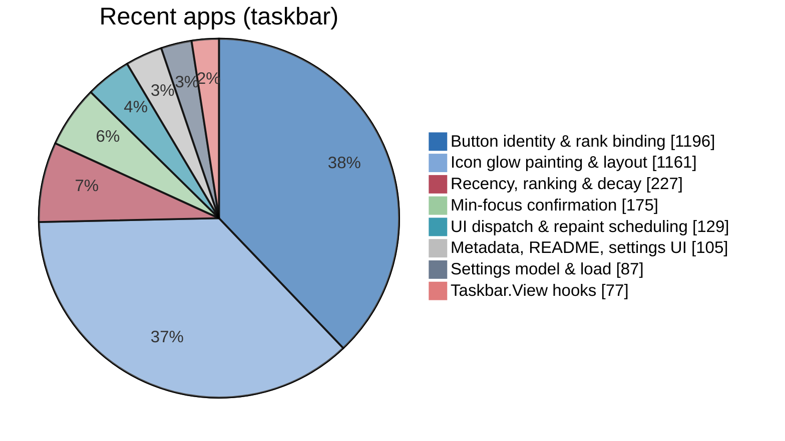
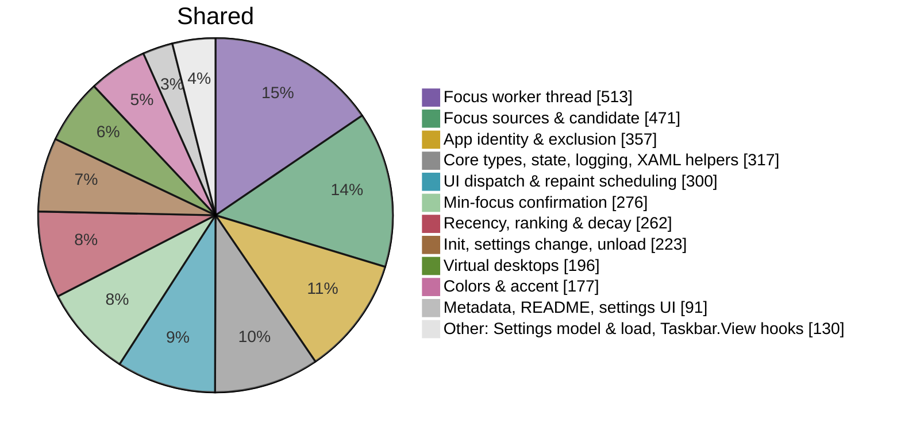
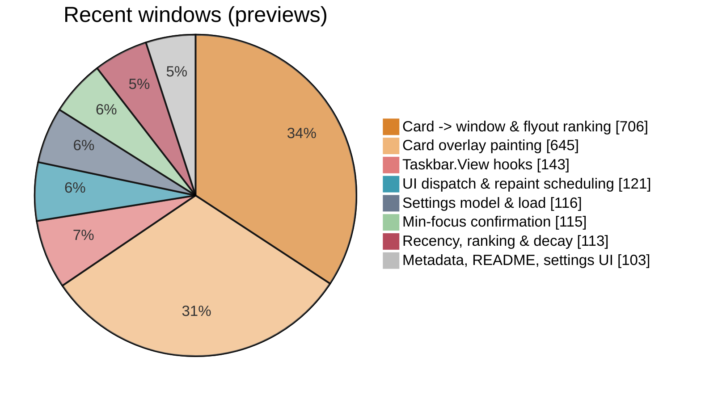

# Code breakdown: recent apps vs recent windows

<!-- Generated by tools/code_breakdown.py from src/. Do not edit by hand; rerun the script. -->

The mod is 8532 lines in 22 parts under `src/` (6866 code lines: not blank, not comment, metadata excluded). Every line is assigned to one of three domains and one feature area by `tools/code_breakdown.py` (classification per function, struct and global; comments go with the item below them).

| Domain | What it is | Lines | Share | Code lines |
|---|---|---:|---:|---:|
| **Recent apps (taskbar)** | Taskbar icon ranks: app recency, button identity, glow painting | 3157 | 37.0 % | 2536 |
| **Shared** | Focus sources, min-focus machine, desktops, identity, threads, lifecycle | 3313 | 38.8 % | 2658 |
| **Recent windows (previews)** | Flyout card ranks: window recency, card -> window, card painting | 2062 | 24.2 % | 1672 |

## Domain split

Without the shared part, the taskbar half is 60.5 % and the preview half 39.5 % of the feature-specific code.

## Where the lines go

Left: source parts. Middle: domain. Right: feature area. An area fed by more than one domain has a shared core plus feature-specific branches (for example the min-focus machine: one shared state machine, an app track and a preview track).

## Feature areas inside each domain

### Recent apps (taskbar) (3157 lines)

### Shared (3313 lines)

### Recent windows (previews) (2062 lines)

## Feature area x domain

Lines (code lines in brackets). A feature with numbers in more than one column is partly shared.

| Feature area | Recent apps | Shared | Recent windows | Total |
|---|---:|---:|---:|---:|
| Button identity & rank binding | 1196 (977) |  |  | 1196 |
| Icon glow painting & layout | 1161 (1004) |  |  | 1161 |
| Card -> window & flyout ranking |  |  | 706 (615) | 706 |
| Card overlay painting |  |  | 645 (535) | 645 |
| Recency, ranking & decay | 227 (173) | 262 (226) | 113 (98) | 602 |
| Min-focus confirmation | 175 (137) | 276 (212) | 115 (106) | 566 |
| UI dispatch & repaint scheduling | 129 (107) | 300 (254) | 121 (106) | 550 |
| Focus worker thread |  | 513 (445) |  | 513 |
| Focus sources & candidate |  | 471 (367) |  | 471 |
| App identity & exclusion |  | 357 (296) |  | 357 |
| Core types, state, logging, XAML helpers |  | 317 (254) |  | 317 |
| Metadata, README, settings UI | 105 (0) | 91 (0) | 103 (0) | 299 |
| Settings model & load | 87 (75) | 78 (60) | 116 (93) | 281 |
| Taskbar.View hooks | 77 (63) | 52 (41) | 143 (119) | 272 |
| Init, settings change, unload |  | 223 (191) |  | 223 |
| Virtual desktops |  | 196 (161) |  | 196 |
| Colors & accent |  | 177 (151) |  | 177 |
| **Total** | **3157** | **3313** | **2062** | **8532** |

## Source parts

How pure each part is. Mixed parts are where the two halves meet.

| Part | Lines | Recent apps | Shared | Recent windows | Mostly |
|---|---:|---:|---:|---:|---|
| `00-metadata.cpp` | 299 | 105 | 91 | 103 | Recent apps (taskbar) (35 %) |
| `01-includes-settings.cpp` | 259 | 61 | 170 | 28 | Shared (66 %) |
| `02-state.cpp` | 494 | 153 | 310 | 31 | Shared (63 %) |
| `03-virtual-desktops.cpp` | 226 | 31 | 190 | 5 | Shared (84 %) |
| `04-helpers.cpp` | 646 |  | 646 |  | Shared |
| `05-ranking.cpp` | 179 | 179 |  |  | Recent apps (taskbar) |
| `06-window-recency.cpp` | 99 |  |  | 99 | Recent windows (previews) |
| `07-colors.cpp` | 168 | 27 | 139 | 2 | Shared (83 %) |
| `08-identity-matching.cpp` | 175 | 175 |  |  | Recent apps (taskbar) |
| `09-glow-host.cpp` | 503 | 470 | 33 |  | Recent apps (taskbar) (93 %) |
| `10-taskbar-edge-layout.cpp` | 559 | 555 |  | 4 | Recent apps (taskbar) |
| `11-button-paint.cpp` | 228 | 228 |  |  | Recent apps (taskbar) |
| `12-button-identity.cpp` | 759 | 733 | 26 |  | Recent apps (taskbar) (97 %) |
| `13-previews.cpp` | 561 |  | 33 | 528 | Recent windows (previews) (94 %) |
| `14-preview-overlay.cpp` | 455 |  |  | 455 | Recent windows (previews) |
| `15-preview-paint.cpp` | 474 |  | 4 | 470 | Recent windows (previews) |
| `16-ui-dispatch.cpp` | 327 | 87 | 240 |  | Shared (73 %) |
| `17-taskbar-view-hooks.cpp` | 388 | 193 | 52 | 143 | Recent apps (taskbar) (50 %) |
| `18-focus-promotion.cpp` | 860 | 134 | 616 | 110 | Shared (72 %) |
| `19-focus-thread.cpp` | 498 |  | 498 |  | Shared |
| `20-settings-load.cpp` | 158 | 26 | 48 | 84 | Recent windows (previews) (53 %) |
| `21-entry-points.cpp` | 217 |  | 217 |  | Shared |

## Largest items

Functions and types over 60 lines (with their leading comments).

| Item | Part | Domain | Area | Lines |
|---|---|---|---|---:|
| `ApplyThumbnailHighlight` | 15-preview-paint | Recent windows (previews) | Card overlay painting | 280 |
| `HandleForegroundChanged` | 18-focus-promotion | Shared | Focus sources & candidate | 203 |
| `RefreshThumbnailFlyout_UIThread` | 15-preview-paint | Recent windows (previews) | Card -> window & flyout ranking | 164 |
| `ApplyAllHighlights_UIThread` | 12-button-identity | Recent apps (taskbar) | Button identity & rank binding | 154 |
| `ApplyButtonHighlight` | 11-button-paint | Recent apps (taskbar) | Icon glow painting & layout | 145 |
| `CaptureButton` | 12-button-identity | Recent apps (taskbar) | Button identity & rank binding | 114 |
| `EnsureIconPanelLayoutWatch` | 10-taskbar-edge-layout | Recent apps (taskbar) | Icon glow painting & layout | 113 |
| `WinEventHookThread` | 19-focus-thread | Shared | Focus worker thread | 112 |
| `HookThreadWndProc` | 19-focus-thread | Shared | Focus worker thread | 108 |
| `OnMinFocusTimerElapsed` | 18-focus-promotion | Recent apps (taskbar) | Min-focus confirmation | 107 |
| `PaintNativeContour` | 09-glow-host | Recent apps (taskbar) | Icon glow painting & layout | 100 |
| `RecomputeRanksForDesktopLocked` | 05-ranking | Recent apps (taskbar) | Recency, ranking & decay | 98 |
| `DetectTaskbarEdge` | 10-taskbar-edge-layout | Recent apps (taskbar) | Icon glow painting & layout | 97 |
| `HookTaskbarViewDllSymbols` | 17-taskbar-view-hooks | mixed |  | 95 |
| `Wh_ModSettingsChanged` | 21-entry-points | Shared | Init, settings change, unload | 94 |
| `OnDecayTimer` | 18-focus-promotion | Shared | Recency, ranking & decay | 88 |
| `LoadSettings` | 20-settings-load | mixed |  | 83 |
| `RefreshButtonHighlight` | 17-taskbar-view-hooks | Recent apps (taskbar) | Button identity & rank binding | 76 |
| `ReadPlateShapes` | 09-glow-host | Recent apps (taskbar) | Icon glow painting & layout | 75 |
| `ActivateFocusTracking` | 19-focus-thread | Shared | Focus worker thread | 72 |
| `SchedulePreviewFlyoutRefresh` | 14-preview-overlay | Recent windows (previews) | UI dispatch & repaint scheduling | 71 |
| `WatchRepeaterElementClearing_UIThread` | 13-previews | Recent windows (previews) | Card -> window & flyout ranking | 70 |
| `ResolveHwndFromCardViewModel` | 13-previews | Recent windows (previews) | Card -> window & flyout ranking | 66 |
| `ResolveAppIdentity` | 04-helpers | Shared | App identity & exclusion | 64 |
| `RevokeIconPanelLayoutWatchesOnThisDispatcher` | 10-taskbar-edge-layout | Recent apps (taskbar) | Icon glow painting & layout | 62 |
| `PaintCardOverlay` | 14-preview-overlay | Recent windows (previews) | Card overlay painting | 61 |
| `ParseHexColor` | 07-colors | Shared | Colors & accent | 60 |

## How the classification works

- Domain = which half of the mod needs the item. *Shared* means both halves call it, or it is infrastructure neither works without (focus worker, settings snapshot, UI dispatch, unload).
- Items are classified one by one in `ITEM` in `tools/code_breakdown.py`; unlisted items take their part's default (`FILE_DEFAULT`). A forward declaration takes the class of the definition it declares.
- Items that mix both halves line by line use line ranges (`OVERRIDES`): the README and settings YAML in `00-metadata`, the `Settings` struct, `LoadSettings`, and the Taskbar.View hook table.
- `HandleForegroundChanged`, `OnDecayTimer`, `HandleWindowDestroyed` and `Wh_ModSettingsChanged` serve both halves in one body and count as shared.
- After moving or renaming functions, rerun the script; it warns about classification entries that no longer match an item.
