# State machines

State in the mod, as statecharts. Some machines are **explicit** (a named
state field or enum, one place that drives the transitions); most are
**implicit** (a few flags, ticks or map entries whose combinations behave as
states, changed from several functions). Both kinds are drawn the same way
here; each section says which it is, where the state lives and which thread
owns it.

Source: v0.11.46 (`src/`). Function names are the anchors: search for them
when the code moves. Domain tags match [code-breakdown.md](code-breakdown.md):
**apps** = taskbar icon ranks, **windows** = flyout card ranks, **shared** =
both.

| # | Machine | Kind | Domain | State lives in | Thread |
|---|---|---|---|---|---|
| 1 | [Focus candidate](#1-focus-candidate) | implicit | shared | `g_pendingFocus` | focus worker |
| 2 | [Min-focus track](#2-min-focus-track-app-and-preview) | explicit | shared core, apps + windows tracks | `MinFocusTrack`, `PendingFocus` ticks | focus worker |
| 3 | [App recency record](#3-app-recency-record) | implicit | apps | `DesktopRecencyState.windowAppFocus`, `.appFocusMap`, `.rankedApps` | worker + UI (under `g_stateMutex`) |
| 4 | [Window recency record and card rank](#4-window-recency-record-and-flyout-card) | implicit | windows | `DesktopRecencyState.windowFocusMap` | worker writes, UI reads |
| 5 | [Taskbar button](#5-taskbar-button) | explicit paint cache, implicit running state | apps | `ButtonState` in `g_buttonStates` | UI thread (worker reads) |
| 6 | [Icon full-pass scheduling](#6-icon-full-pass-scheduling) | implicit | apps | `g_fullPassQueuedThreads`, `g_fullRebindTimerArmed`, `g_lastFullRefreshTick` | UI threads + worker |
| 7 | [Flyout refresh scheduling](#7-flyout-refresh-scheduling) | implicit | windows | `thread_local g_previewFlyoutRefresh*`, `g_thumbRelayoutDepth` | UI thread |
| 8 | [Current virtual desktop](#8-current-virtual-desktop) | implicit | shared | `g_currentDesktopId`, `g_haveCurrentDesktop` | worker (UI reads) |
| 9 | [Decay timer](#9-decay-timer) | implicit | shared | `g_decayTimerArmed`, `emptySweepsLeft` | focus worker |
| 10 | [Focus worker thread](#10-focus-worker-thread) | implicit | shared | `g_winEventHookThread`, `g_hookThreadHwnd`, ready event | Windhawk thread + worker |
| 11 | [Mod lifecycle](#11-mod-lifecycle) | implicit | shared | `g_unloading`, `g_taskbarViewHookAttempted`, `g_taskbandResolveReady` | Windhawk thread, loader thread |
| 12 | [Unload drain of one UI dispatcher](#12-unload-drain-of-one-ui-dispatcher) | explicit | shared | `DispatcherOpEnd`, `DrainProof`, `highRan` | Windhawk thread |
| 13 | [Legacy preview-style transition](#13-legacy-preview-style-transition) | explicit, persisted | windows | mod storage `legacyPreviewStyleState` | Windhawk thread |
| 14 | [XAML event watches](#14-xaml-event-watches) | implicit | apps + windows | `g_layoutWatches`, `g_repeaterWatches` | UI thread |

## How the machines connect

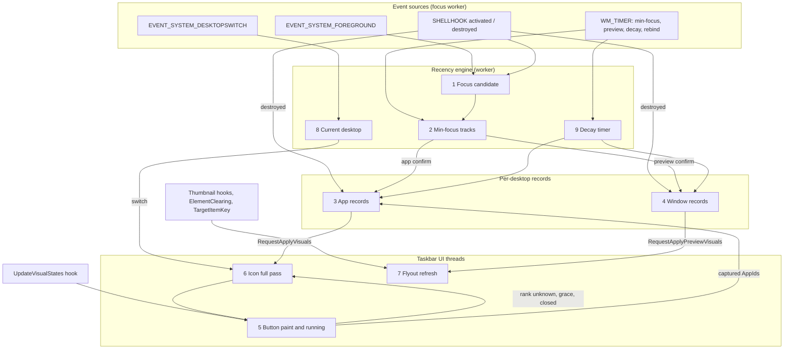

---

## 1. Focus candidate

**Implicit, shared.** `g_pendingFocus` (`PendingFocus`) is the window that has
foreground and has not been confirmed yet. `valid` is the state bit; the two
`*Confirmed` flags say which tracks (machine 2) are done. Driven by
`HandleForegroundChanged`, `HandleWindowDestroyed`, `OnVirtualDesktopSwitched`,
the `WM_APP_SETTINGS_CHANGED` handler and the track handlers.

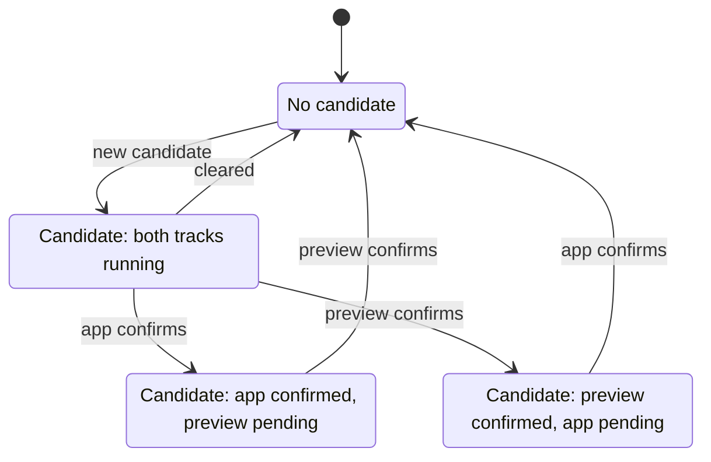

*New candidate*: the foreground window resolves to an app
(`ResolveAppIdentity`); a new `PendingFocus` with both start ticks = now.
Any candidate state can be *cleared* (table). With previews off, the app
confirm clears the candidate directly.

While a candidate exists:

| Event | Effect |
|---|---|
| Foreground, same key, candidate on the current desktop | Stays. Deadlines kept (`EnsurePendingAppTimer`, `EnsurePendingPreviewTimer`). A different HWND of the app resets `previewStartTick` and restarts the preview track only. |
| Foreground, other app (or same key on another desktop) | Replaced by a new candidate: both timers cancelled and restarted. |
| Transient foreground (Alt-Tab, taskbar, desktop, IME) | No change. The tracks handle it as grace (machine 2). |
| Foreground not resolvable (shell host, ignored, excluded) | **Cleared**, both timers cancelled. |
| Candidate HWND destroyed (`HSHELL_WINDOWDESTROYED`) | **Cleared**. |
| Desktop switch, candidate on another desktop | **Cleared**. |
| Settings change | **Cleared** if now excluded; otherwise both timers re-armed for the time left. |
| App track fails (focus left, grace over, excluded) | **Cleared** (`DropPendingFor`). |
| Preview track fails | Stays; only that track stops. |

Notes

- *Same app* means the same key **and** the candidate's desktop is the
  current one. The key is `APPID:<Explorer AppId>`, or provisional
  `WINDOW:<hwnd>` when no captured button lists the window yet
  (`ResolveAppIdentity`, `noButton`).
- After the app confirms, a candidate whose preview track stopped stays
  valid until the next foreground change (see Observations).
- On every non-transient change the icons are repainted debounced
  (`RequestApplyVisualsDebounced`) when ranks exist, so Alt-Tab does not leave
  ranked icons unpainted while the timers run.

## 2. Min-focus track (app and preview)

**Explicit, shared core.** Since 0.11.45 both confirmations are one machine:
`MinFocusTrack` names the timer, seconds, start tick and retry field;
`TakePendingForConfirm` -> `MinFocusDeadlineReached` -> track-specific
confirm. `ArmOrConfirmTrack`, `EnsurePendingAppTimer` and
`EnsurePendingPreviewTimer` (re)enter it. Timers live on the worker's hidden
window.

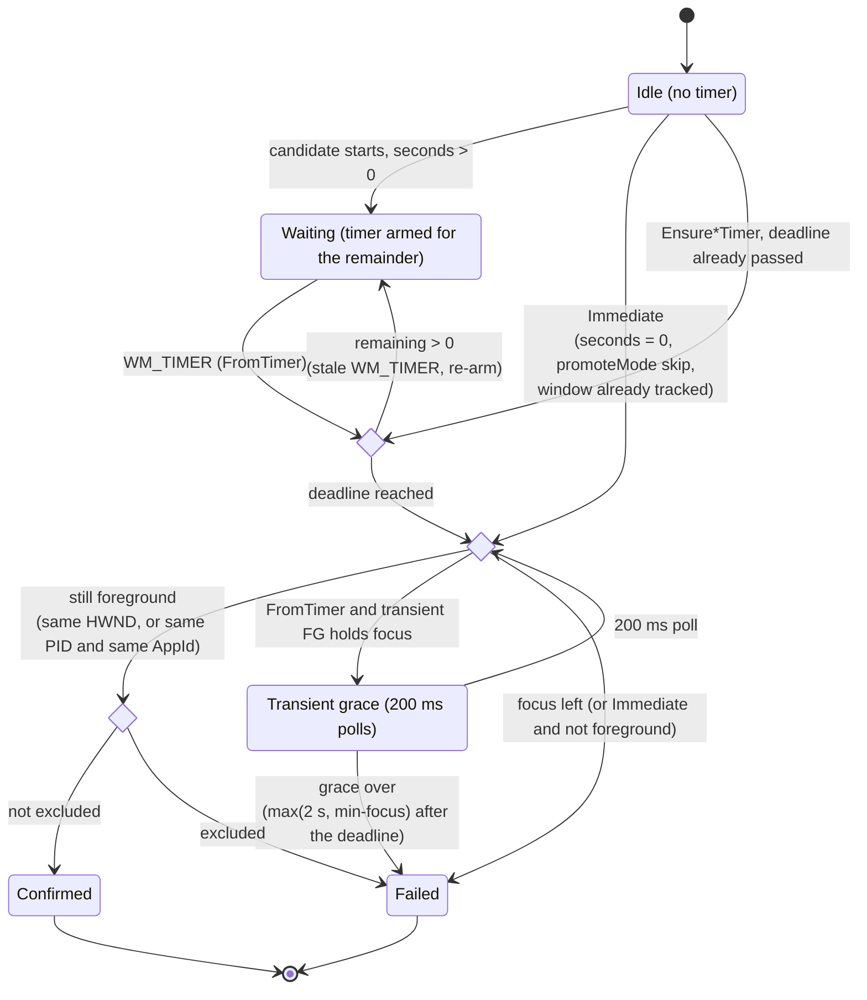

| | App track (**apps**) | Preview track (**windows**) |
|---|---|---|
| Timer | `kMinFocusTimerId` | `kPreviewMinFocusTimerId` |
| Seconds | `minFocusSeconds` (8) | `previews.minFocusSeconds` (1) |
| Start tick | `focusStartTick` | `previewStartTick` (reset when the HWND changes within the app) |
| Retry field | `transientRetryStartTick` | `previewTransientRetryStartTick` |
| Immediate when | `ShouldSkipAppMinFocus`: min 0, or `promoteMode` (tracked within decay / in top N) | min 0, or `IsWindowRecentForPreviewLocked` |
| Confirmed | `windowAppFocus[hwnd]` stamped, `RecomputeRanksForDesktopLocked`, `RequestApplyVisuals`, `appConfirmed` | `StampWindowRecencyLocked`, `RequestApplyPreviewVisuals`, `previewConfirmed` |
| Failed | drops the candidate (machine 1) | stops this track only; excluded counts as done |
| Desktop credited | `ConfirmDesktopId` (registry lag after a switch) | same |

`KillTimer` does not remove a `WM_TIMER` already queued, hence the
"remaining > 0, re-arm" edge: a stale tick never confirms a newer candidate
early.

## 3. App recency record

**Implicit, apps.** Since 0.11.46 the recency record is per window
(`WindowAppFocus`); the app record (`AppFocusInfo`) is derived from it at
every recompute (`DeriveAppsFromWindowsLocked`) and outlives its windows until
decay. `RecomputeRanksForDesktopLocked` decides the visible state.

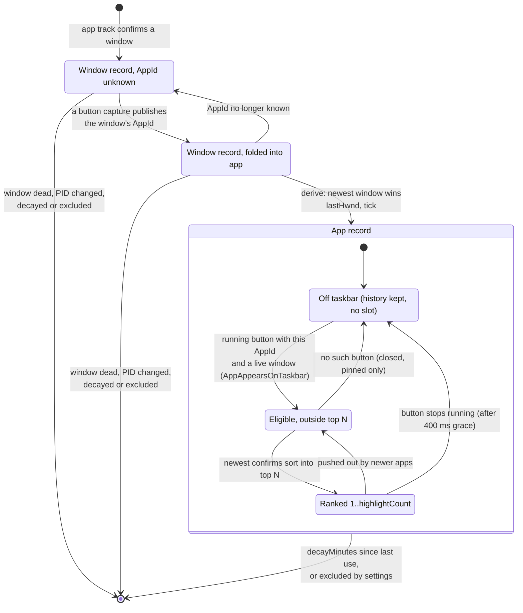

Notes

- *Never Combine*: when any confirmed window of an app owns its own button
  (`g_uncombinedWindowsByThread`), the app becomes one ranked unit per window
  (`perWindow`).
- Re-focus within `decayMinutes` counts as *already tracked*, which lets
  machine 2 skip the wait (default `promoteMode`).
- `HandleWindowDestroyed` removes the window record at once; the app record
  stays until decay.
- Last use (0.12.1): a window record's tick is its confirm time, moved
  forward to the last input while it stays in front (decay tick) and when it
  leaves the foreground — only within a stretch in front in which it was
  confirmed. Same for the preview record in machine 4.

## 4. Window recency record and flyout card

**Implicit, windows.** One record per `HWND` + PID per desktop
(`WindowFocusInfo`). Cards are ranked per flyout, from the records, in
`RefreshThumbnailFlyout_UIThread`.

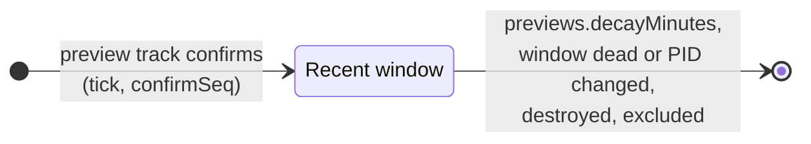

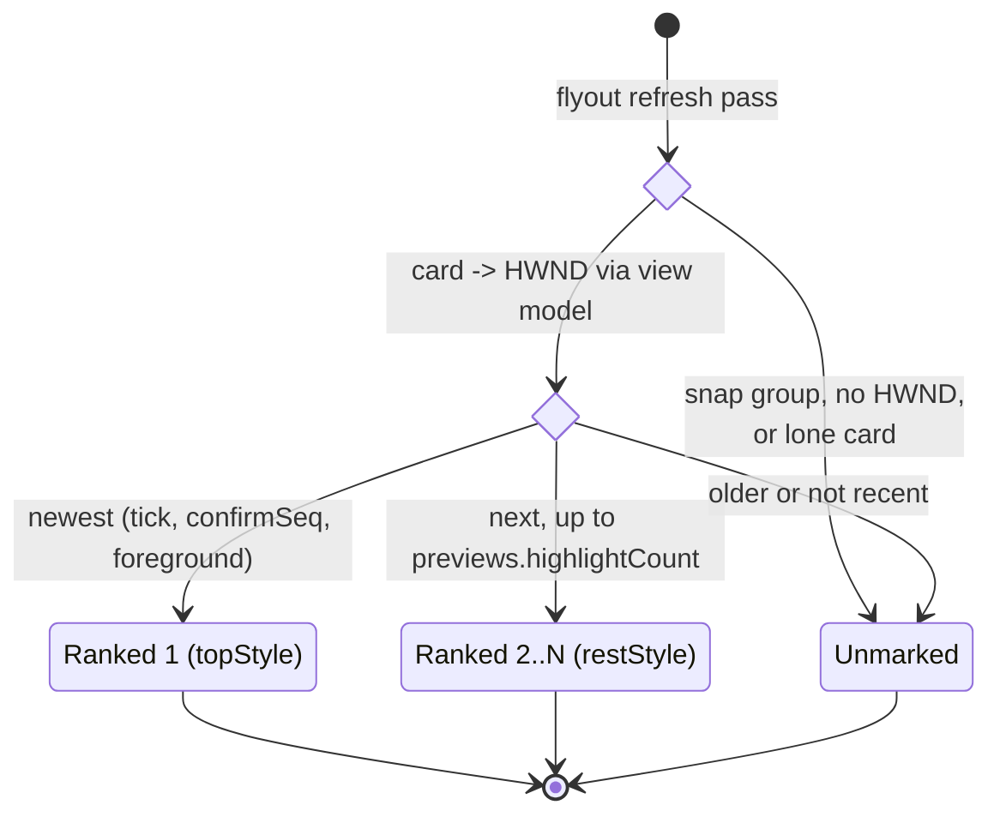

*Snap group*: a snap-group card (`IconsRepeater` with 2+ icons and no
window). *No HWND*: the card's view model gives no window. *Lone card*: a
single-card flyout without `previews.singleWindow`. A window confirmed again
stays *Recent* with a new tick and `confirmSeq`.
A card holds no state between passes; each refresh recomputes it. The paint
keeps the overlay host (`WhRecentFocusThumbGlow`) across ranked repaints and
removes it when unmarked.

## 5. Taskbar button

**Explicit paint cache, implicit running state; apps.** One `ButtonState`
per `TaskListButton` (keyed by `IUnknown*`, guarded by a weak ref). Two
orthogonal regions: whether the button counts as running, and what the mod
last painted on it.

Running state (rank eligibility):

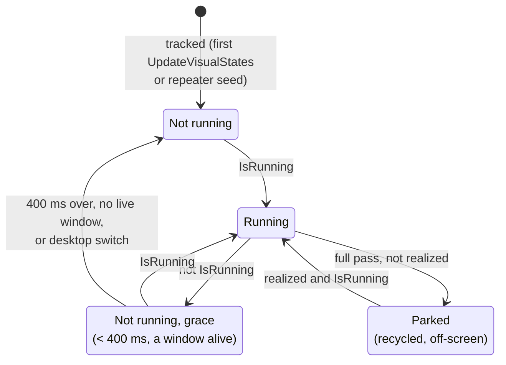

Paint cache (`lastPaintRank`):

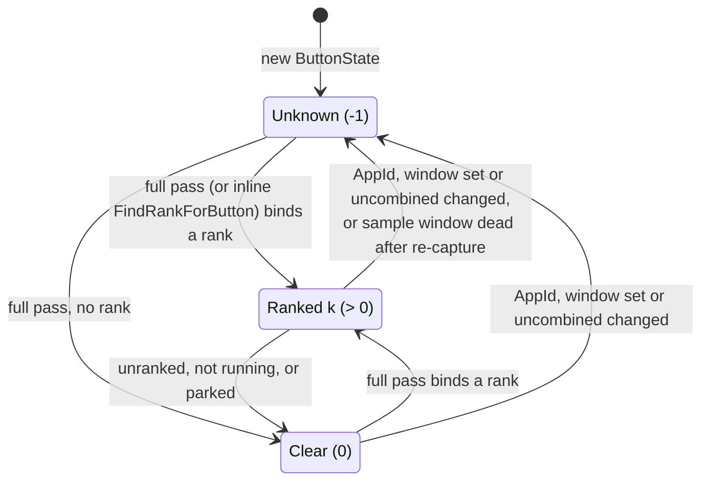

Notes

- *Parked*: `ItemsRepeater` keeps recycled buttons parented off-screen;
  `GetElementIndex` is -1. A desktop switch also resets *Running* to not
  observed until the next `IsRunning` read (`ClearButtonRunningGrace`). A
  dead weak ref removes the state from any region (`PruneDeadButtonStates`).
- A ranked button repainted by `UpdateVisualStates` stays *Ranked k*; the
  repaint is a no-op when settings generation, accent, taskbar edge and box
  size are unchanged (side-bar style).
- Grace keeps **rank eligibility** only (`AppAppearsOnTaskbar`); the glow
  follows `IsRunning` immediately (`ButtonCountsAsRunning` returns false).
- From *Unknown*, the hover-hot hook (`RefreshButtonHighlight`) may bind
  inline with `FindRankForButton` when ranks exist, and asks for a full pass
  (machine 6) whenever the rank is unknown or a sweep is pending.

## 6. Icon full-pass scheduling

**Implicit, apps.** A *full pass* is `ApplyAllHighlights_UIThread`: capture
every live button, recompute ranks, bind ranks to buttons. Requests come from
the worker (`RequestApplyVisuals`, `RequestApplyVisualsDebounced`) and from the
UI (`ScheduleRefreshAllHighlights`). One queued pass per UI thread.

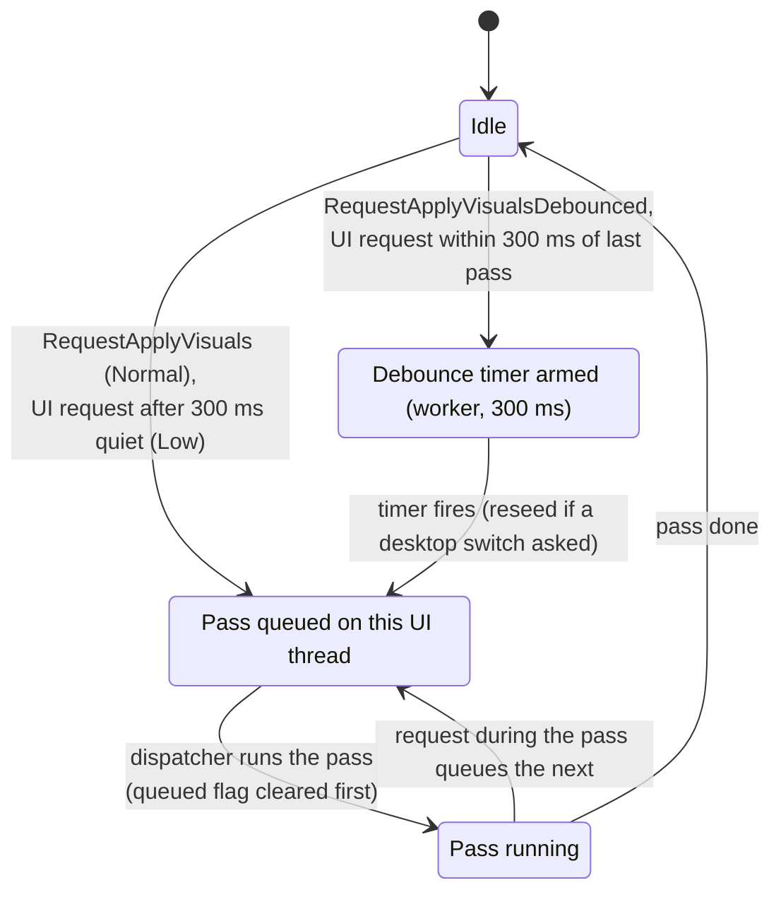

More debounced requests while the timer is armed do not extend it; more
requests while a pass is queued coalesce into it.

Flags read by the pass: `g_pendingOverlaySweep` (decay, desktop switch:
visit every button, cleared when the pass ends) and
`g_buttonSeedGeneration` (re-walk each taskbar's `ItemsRepeater` once per
bump). On the UI thread itself `RequestApplyVisuals` runs the pass inline.

## 7. Flyout refresh scheduling

**Implicit, windows.** Per UI thread. `OnApplyTemplate`,
`put_ThumbnailSource`, `ElementClearing`, `TargetItemKey` and
`RequestApplyPreviewVisuals` all funnel into `SchedulePreviewFlyoutRefresh`.

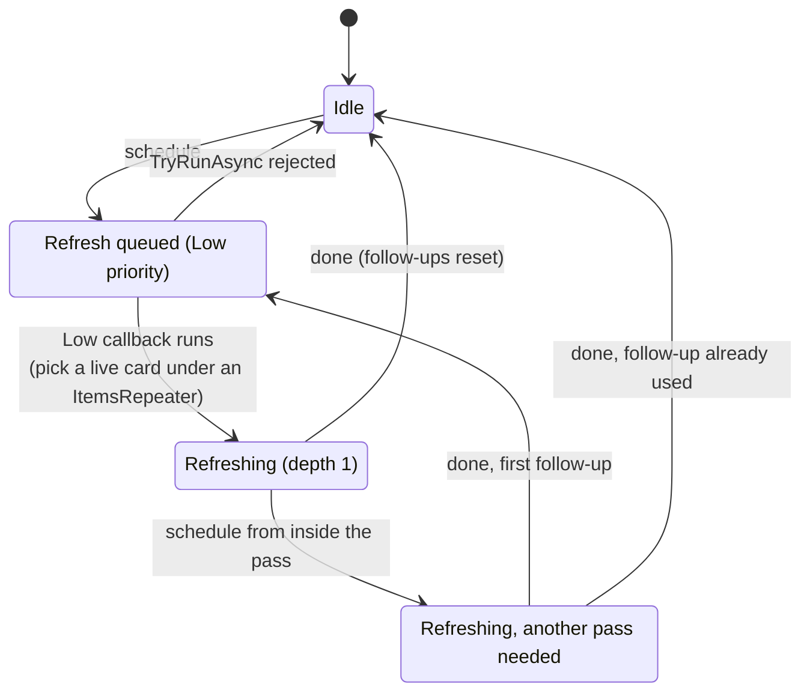

Schedules while a refresh is queued coalesce into it. `TargetItemKey` also
clears every tracked card first, but only when the key
differs from the last one on that thread (`static thread_local lastKey`).

## 8. Current virtual desktop

**Implicit, shared.** The worker owns the desktop GUID (registry
`CurrentVirtualDesktop`, `IVirtualDesktopManager` fallback); UI threads only
read `g_currentDesktopId`.

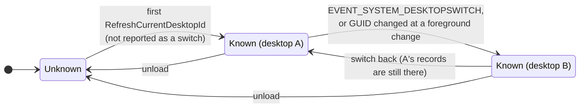

On every switch: clear button running grace (machine 5), drop a candidate
that belongs to another desktop (machine 1), set the overlay sweep, bump the
seed generation and re-seed again on the debounced pass, then repaint icons
(immediate and debounced) and flyouts. Recency maps are per desktop
(`g_desktopMaps`), so nothing is lost.

## 9. Decay timer

**Implicit, shared.** A 30 s periodic timer that is armed only while there
is something to decay.

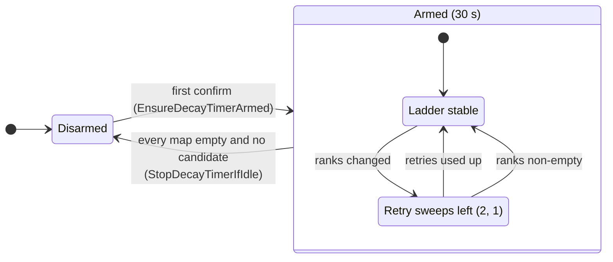

Every tick recomputes and prunes the current desktop, then the other
desktops one hold at a time, and erases desktops with no records. A changed
ladder, or an empty one while retries are left, sets the overlay
sweep and requests a full pass; a changed window count repaints flyouts.

## 10. Focus worker thread

**Implicit, shared.** `StartWinEventHookThread` / `WinEventHookThread` /
`StopWinEventHookThread`.

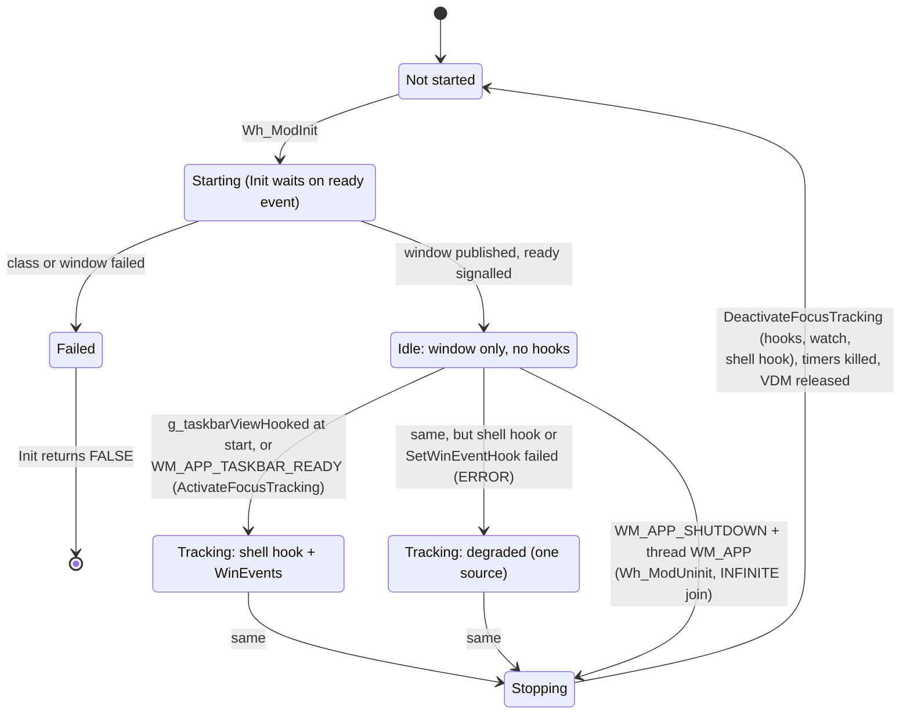

Activation posts the current foreground window, so the first candidate does
not wait for a focus change. A foreground posted while *Idle* is ignored: a
folder-window `explorer.exe` that never loads `Taskbar.View.dll` stays *Idle*
for its whole life (0.12.1). No polling fallback exists in either tracking
state.

## 11. Mod lifecycle

**Implicit, shared.**

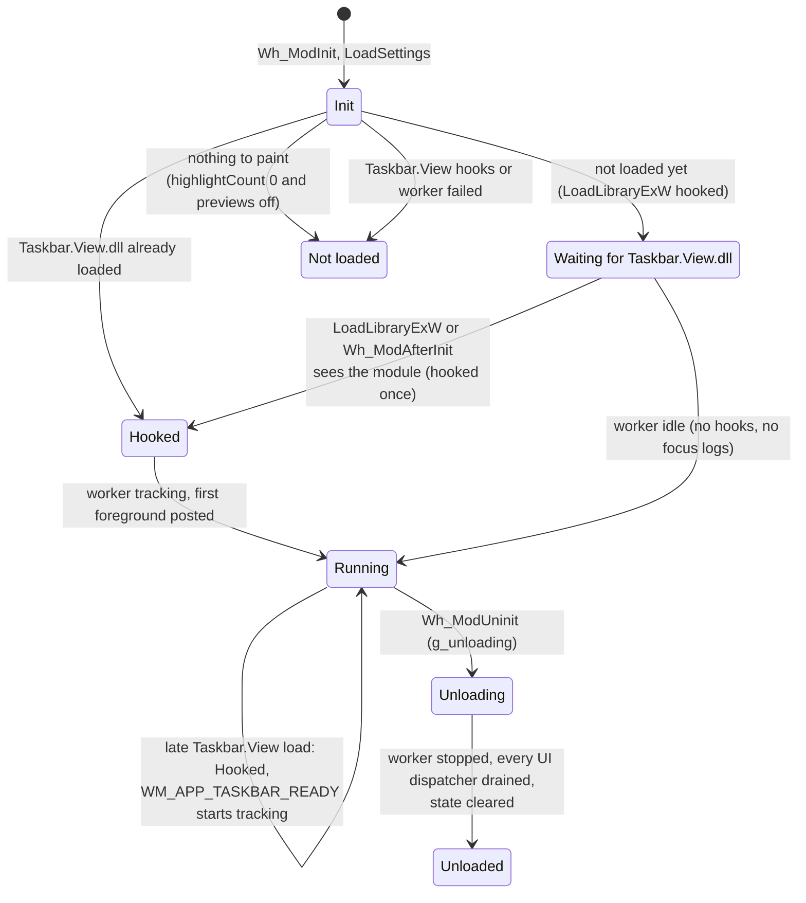

`Wh_ModSettingsChanged` keeps the mod in *Running*: reload settings, drop
newly excluded records, recompute ranks, re-arm or drop the candidate's
timers on the worker, repaint. `Running` without `Hooked` paints nothing: ranks wait for the first
`TaskListButton` (`RunOnUiThread` logs "no dispatcher anchor yet").

## 12. Unload drain of one UI dispatcher

**Explicit, shared.** `DrainOneUiDispatcher` with `DispatcherOpEnd` and
`DrainProof`. Runs per remembered dispatcher, after the worker has stopped.
No timeouts: a dispatcher that keeps rejecting keeps the mod loaded.

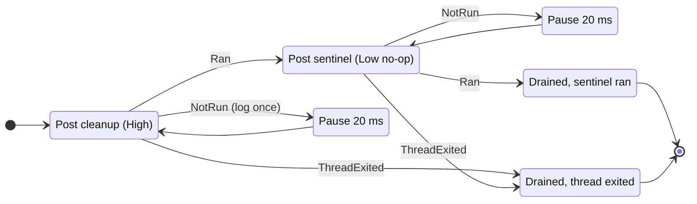

The cleanup handler clears icon glows and flyout cards and revokes the
`SizeChanged` and `ElementClearing` watches of that dispatcher (machine 14).
*Ran* is proven by the operation's `Completed` (or by polling its status),
never by a signal from inside the callback.

## 13. Legacy preview-style transition

**Explicit, persisted, windows.** `ApplyLegacyPreviewStyle` keeps a user's
0.11.1 `previews.style` choice after the split into `topStyle` / `restStyle`
until they save settings. Remove a release or two after 0.12.0. Each load in
state 1 applies the legacy style to both ranks.

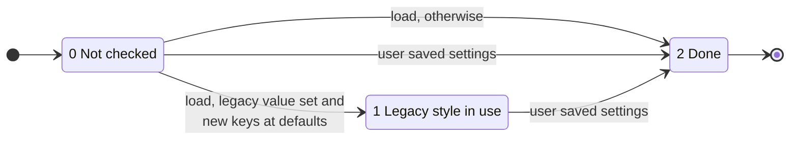

## 14. XAML event watches

**Implicit, apps + windows.** Same pattern twice: `IconPanel.SizeChanged`
(`EnsureIconPanelLayoutWatch`, apps: re-detect the taskbar edge and reposition
glows) and flyout `ItemsRepeater.ElementClearing`
(`WatchRepeaterElementClearing_UIThread`, windows: refresh after a card is
removed).

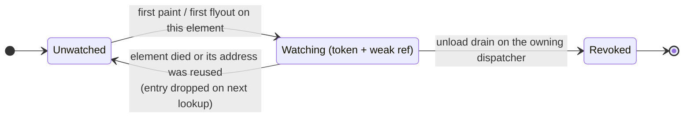

Events are ignored while unloading (and, for `SizeChanged`, during the
mod's own relayout). A registration that loses a race with another one is revoked at once.
Entries left after the drain are logged as `ERROR: ... not revoked`.

---

## Observations

Found while tracing the machines; worth a look, not verified live.

- **Provisional key restarts the app wait.** A window focused before any
  captured button lists it gets the key `WINDOW:<hwnd>`. If a later
  foreground event for the same window arrives after the button capture (for
  example after Alt-Tab and back), the key is now `APPID:...`, so
  `HandleForegroundChanged` treats it as another app and restarts the app
  min-focus wait. Phase 4 (read Explorer's `TaskbarAppsList`, drop provisional
  keys) would remove this. **Fixed in 0.11.47:** the same window (HWND + PID)
  with a pending `WINDOW:` key counts as the same app, and the pending key is
  upgraded to the `APPID:` key. (0.11.46 already keeps recency per window, so
  `WINDOW:` exists only as this pending identity.)
- **Lingering candidate.** If the preview track gives up but the app track
  later confirms, the candidate stays valid with `appConfirmed` set until the
  next foreground change, and that window gets no preview recency for this
  visit. One way there with default timers: hold Alt-Tab from about 1 s to
  past 3 s (preview deadline 1 s + 2 s grace), then land back on the same
  app without a new foreground event; the app track (8 s) still confirms.
  **Fixed in 0.11.47:** after the app confirm, a still-unconfirmed preview
  track is resumed (`EnsurePendingPreviewTimer`; its deadline has passed, so
  it confirms if the window is in front).
- **Desktop switch first seen by the decay tick.** `OnDecayTimer` calls
  `RefreshCurrentDesktopId` and ignores whether the desktop changed. If the
  registry still had the old GUID when `EVENT_SYSTEM_DESKTOPSWITCH` was
  handled (the lag 0.11.42 works around at confirm), and the decay tick is
  the next reader, the new desktop becomes current without the switch steps
  of machine 8 (grace clear, sweep, re-seed, repaint). The next foreground
  change does not catch up either, because the GUID no longer differs. This
  needs no foreground change between the switch and the tick, for example a
  switch to an empty desktop. **Fixed in 0.11.47:** `HandleForegroundChanged`
  checks the desktop before its transient early return (an empty desktop
  gives the desktop / taskbar foreground), and the decay tick runs
  `OnVirtualDesktopSwitched` when it sees the change first.
- **Two clocks for one rebind debounce.** The worker's 300 ms timer
  (`g_fullRebindTimerArmed`) and the UI's `g_lastFullRefreshTick` (per thread)
  both debounce full passes; machine 6 shows how they meet.
