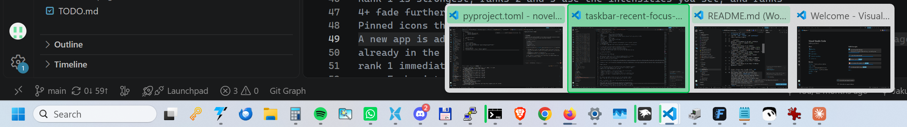
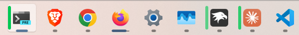
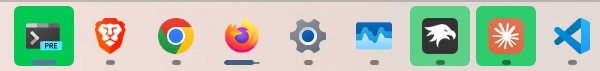
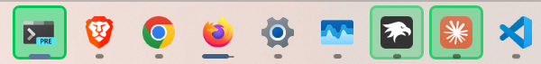
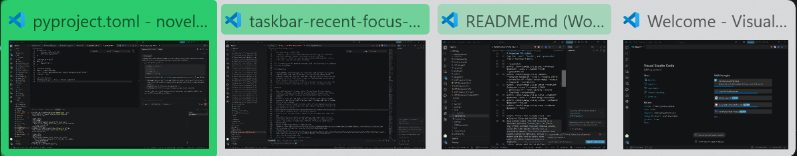
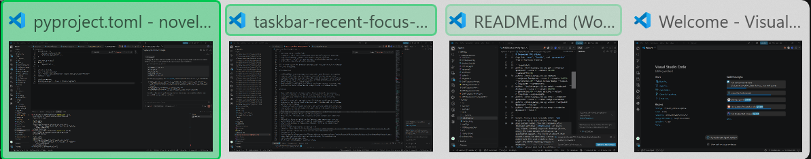

<!-- Draft of the in-mod README (==WindhawkModReadme==), restructured
     2026-11-22. Not in the mod yet: mark it up, then it replaces the README
     block in src/00-metadata.cpp. Notes for review at the bottom. -->

# Taskbar Recent Focus Highlight

Highlights the taskbar icons of the apps you were just working in, so you
find them again on a crowded taskbar. Inside a multi-window preview flyout,
it ranks that app's windows the same way.

## Styles

The most recently used app is marked strongest, the next ones fainter.
Three styles to choose from:

- **Side bar** (default): a bar beside the icon.

  
- **Plate**: the button's own rounded plate, tinted in the highlight color.

  
- **Plate with accent**: the same plate, lighter, with an accent border.

  

On a button with several windows the plates also tint its stacked edge. An
app that asks for attention keeps Windows' red marks on top.

## How apps get ranked

- An app counts after **8 s** in front (Minimum focus time); Alt+Tab passing
  through does not.
- It drops out **30 min** after you last *used* it (typing or clicking), so
  the app you work in stays highlighted.
- Only running apps. One list per virtual desktop, the same on every
  monitor.
- Start, Alt+Tab, the taskbar, desktop and lock screen do not count.

## Previews

Flyout window previews are ranked by their last use, for each running app
independently (own timing: 1 s minimum focus, 15 min decay). Rank 1 and the
rest have separate styles: tinted card, tinted title (either with an accent
border), or a bar under the title.

Single-window flyouts only with **Also mark single-window previews**. Just
the active window marked? Use the much lighter
[taskbar-active-window-highlight](https://windhawk.net/mods/taskbar-active-window-highlight).

## Settings

- **General**: how many apps, minimum focus time, when to skip it on
  coming back, decay, exclude list.
- **Taskbar icons**: style, color (system accent or your own), strength per
  rank, side bar size, fill, accent border width.
- **Thumbnail previews**: on/off, how many windows, single-window previews,
  styles, strength per rank, their own minimum focus and decay.

The exclude list takes process names, paths or app IDs. Two buttons of one
program (Total Commander and its Lister, for example) have different app
IDs; with the mod log on, each button's ID is shown as
`Button identity: ... appId=`.

## Compatibility and limitations

- Works with Windows 11 Taskbar Styler. The mod only adds its own elements:
  it changes nothing Windows draws, takes no space, stays visible on hover
  and follows themes that resize the buttons.
- Icons are matched by the app ID Explorer itself groups buttons by. A
  window without a taskbar button is never ranked.
- **SOLIDWORKS** and other apps that show each open document as its own
  preview card manage those previews themselves, so their previews are not
  marked. Their taskbar icon is ranked normally.
- Enabled while Explorer is already running, the ranks appear after the
  first taskbar button changes (hover or a window switch).

## Credits

- [taskbar-active-window-highlight](https://github.com/ramensoftware/windhawk-mods/blob/main/mods/taskbar-active-window-highlight.wh.cpp):
  reading button windows and preview cards through Explorer's own task
  interfaces, and the "with accent" look.
- [taskbar-volume-control-per-app](https://github.com/ramensoftware/windhawk-mods/blob/main/mods/taskbar-volume-control-per-app.wh.cpp):
  finding a taskbar button's task group.
- [taskbar-thumbnail-reorder](https://github.com/ramensoftware/windhawk-mods/blob/main/mods/taskbar-thumbnail-reorder.wh.cpp):
  handling the preview flyout.

<!-- ===================== Notes for review =====================

Dropped from the current README:
- "Rank 1 is strongest; ranks 2 and 3 use the intensities you set, and
  ranks 4+ fade further" -> one sentence at the top of Styles; the
  settings descriptions keep the details.
- The bar side detail ("left on a bottom/top taskbar, under the icon on a
  left/right taskbar"): the setting describes it.
- "recency ladder (independent of icon ranks)", "used within the preview
  decay", CabinetWClass, "card view model", the Wh_Log / no debug toggle
  note, "All of those are in the Windhawk settings panel. Disable the mod
  in Windhawk to clear highlights."
- "a card is left unmarked rather than guessed from its title": implied
  by Limitations; say if you want it back.

Proposed UI renames (ids unchanged, no transition needed):
- "Glow color" -> "Highlight color", "Custom glow color" -> "Custom
  highlight color".
- "Intensity rank N" -> "Strength rank N"? (README now says strength.)
  Only if you like it; "intensity" is fine too.
-->
