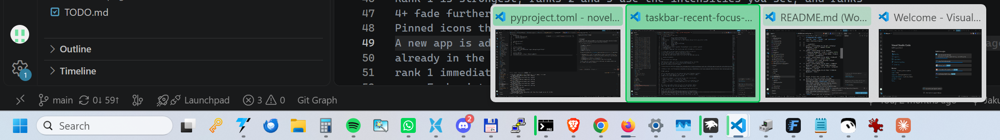
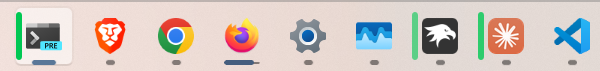
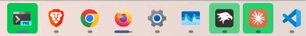
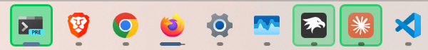
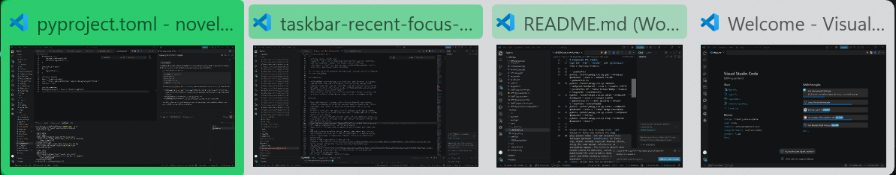
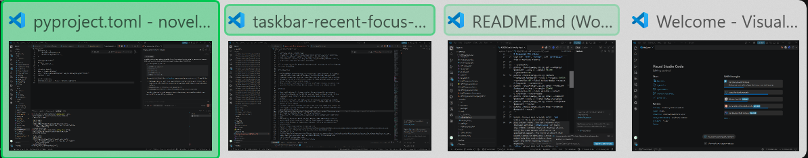

<!-- Draft of the in-mod README (==WindhawkModReadme==) for 0.12.2.
     Based on src/00-metadata.cpp and doc/readme-draft-0.12.1.md.
     Ready to replace the README block in src/00-metadata.cpp once approved. -->

# Taskbar Recent Focus Highlight

Highlights the taskbar icons of the apps you were just working in, so they
stand out on a crowded taskbar. In multi-window hover previews, it ranks
that app's windows the same way.

## Icon styles

Highlights fade by rank — strongest for your most recent app, fainter for
earlier ones (top 3 by default). Choose from three styles:

- **Side bar** (default): a bar beside the icon.

  
- **Plate**: tints the button's rounded plate.

  
- **Plate with accent**: a lighter tinted plate with an accent border.

  

For grouped buttons, both plate styles also tint the stacked edge. Windows'
red attention indicators stay on top.

## How apps get ranked

- **Focus threshold** — An app joins the list after staying focused for 8 s
  (configurable), filtering out quick Alt+Tab glances.
- **Instant return** — Switching back to a recent app moves it to rank 1
  right away.
- **Idle decay** — Highlights expire 30 minutes after your last keyboard or
  mouse input in that app, so the app you are actively using stays
  highlighted while idle ones age out.
- **Running apps only** — Closed pinned icons are never highlighted.
- **Per virtual desktop** — Each desktop keeps its own list; multi-monitor
  taskbars stay in sync.
- **Smart filtering** — File Explorer windows are ranked; shell UI (Start,
  taskbar, desktop, IME) is ignored.

## Preview flyouts

Hovering a grouped taskbar icon with two or more windows ranks that app's
windows independently — the window you worked in last is always rank 1 in
its flyout, even if you switched to other apps afterward. Previews use
shorter, separate timers (1 s focus threshold, 15 min decay).

Rank 1 and ranks 2+ are styled separately: whole plate, title plate, either
with an accent border, a thin bar under the title, or unmarked (ranks 2+).

Single-window flyouts are left alone unless **Also mark single-window
previews** is enabled. If you only want the currently active window
highlighted in previews,
[taskbar-active-window-highlight](https://windhawk.net/mods/taskbar-active-window-highlight)
is a lighter mod built specifically for that.

## Settings

- **General**: number of highlighted apps, focus threshold, re-focus
  behavior, decay time, and exclude list.
- **Taskbar icons**: style, color (system accent or custom), per-rank
  intensity, side bar size, fill opacity, and accent border thickness.
- **Thumbnail previews**: on/off, number of highlighted windows,
  single-window previews, styles, per-rank intensity, tint opacity, and
  separate focus/decay timers.

The exclude list accepts process names, full paths, or Explorer app IDs
(useful for separating two taskbar buttons from the same executable, such as
Total Commander and Lister — enable mod logs to find `Button identity: ...
appId=`).

## Compatibility and limitations

- **Windows 11 taskbar only**: targets the native Windows 11 XAML taskbar
  (classic Windows 10 taskbar replacements are not supported).
- **Taskbar Styler compatible**: draws only its own overlays with zero
  layout footprint, leaves native elements untouched, stays visible on
  hover, and adapts to themes that resize taskbar buttons.
- **Exact button matching**: icons match by Explorer's own taskbar app ID;
  windows without a taskbar button are never ranked.
- **Custom document previews**: apps that show each open document as its
  own preview card (such as SOLIDWORKS) manage those previews themselves, so
  individual cards are not marked; their taskbar icon still ranks normally.
- **Hot-loading**: when enabled while Explorer is already running,
  highlights appear after the first taskbar button updates (on hover or
  window switch).

## Credits

- [taskbar-active-window-highlight](https://github.com/ramensoftware/windhawk-mods/blob/main/mods/taskbar-active-window-highlight.wh.cpp):
  reading button windows and preview cards via WindowsUdk task interfaces,
  and the "with accent" look.
- [taskbar-volume-control-per-app](https://github.com/ramensoftware/windhawk-mods/blob/main/mods/taskbar-volume-control-per-app.wh.cpp):
  resolving a taskbar button's task group.
- [taskbar-thumbnail-reorder](https://github.com/ramensoftware/windhawk-mods/blob/main/mods/taskbar-thumbnail-reorder.wh.cpp):
  flyout `ItemsRepeater` handling.

<!-- ===================== Review notes =====================

Key changes from doc/readme-draft-0.12.1.md:
- "How apps get ranked": converted to bold-lead one-liners (Focus threshold,
  Instant return, Idle decay, Running apps only, Per virtual desktop, Smart
  filtering) so the rules scan in a couple of seconds.
- Tightened clumsy/repetitive phrases:
  - "so you find them again" -> "so they stand out"
  - "An app that asks for attention keeps Windows' red marks on top" ->
    "Windows' red attention indicators stay on top"
  - "marks the windows you used last in that app: the one you used last is
    rank 1 even if you have used other apps since" -> removed the triple
    "used" repetition
  - "when to skip it on coming back" -> "re-focus behavior"
  - "Icons are matched by the app ID Explorer itself groups buttons by" ->
    "icons match by Explorer's own taskbar app ID"
  - "Enabled while Explorer is already running, the ranks appear..." ->
    fixed dangling participle ("when enabled while Explorer is already
    running, highlights appear...")
- Kept "intensity" in Settings to match the current UI labels in
  src/00-metadata.cpp (switch to "strength" if you rename those labels).
- Added a one-line "Windows 11 taskbar only" bullet under Compatibility.
-->
